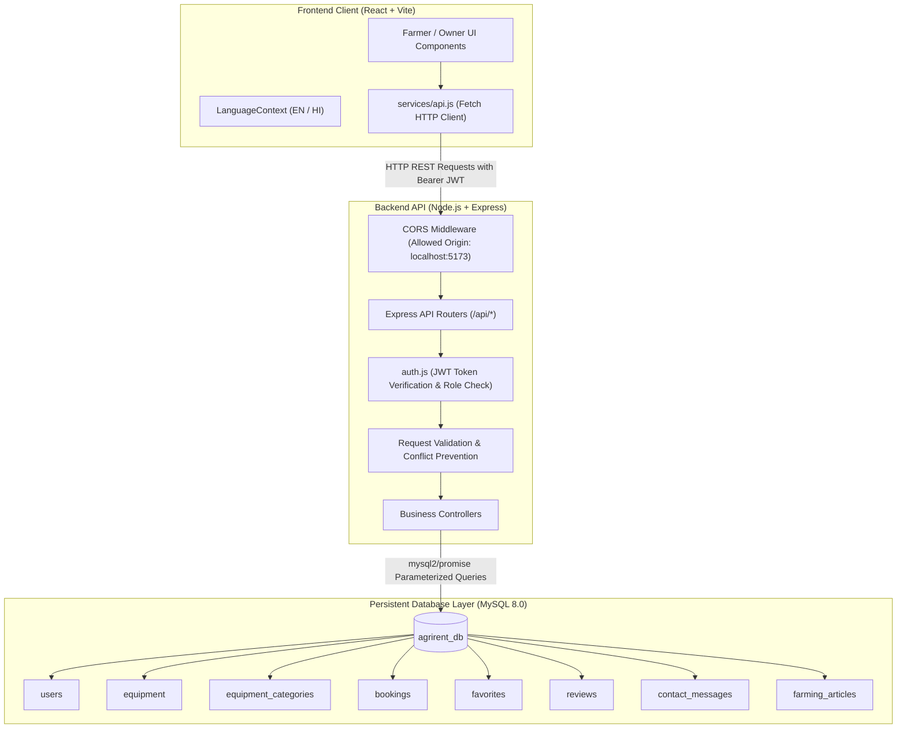

# AgriRent — Complete Data Flow & Architecture Guide

> **"Rent the Right Farm Equipment. Grow More."**  
> This document explains the complete journey of data across AgriRent: from farmer interactions in the React browser interface, through Express REST APIs and validation middleware, into persistent MySQL database tables.

---

## 1. System Architecture Overview



---

## 2. The Four Levels of Data Storage

A common question in college viva is: *"Where does my data live?"* AgriRent utilizes four distinct storage layers, each serving a specific lifecycle:

| Storage Layer | Longevity | Scope | What AgriRent Stores Here |
| :--- | :--- | :--- | :--- |
| **1. React Component State (`useState`, `useMemo`)** | Temporary (Lost on page refresh / unmount) | Current component / active view | Form inputs while typing, search query string, active gallery thumbnail, modal open/close toggle. |
| **2. Browser `localStorage`** | Survives page refresh and browser restart | Single user's browser only | Non-sensitive preferences: Selected language (`'en'` or `'hi'`), active UI region, cached JWT auth token. |
| **3. Server Filesystem (`server/uploads/`)** | Permanent on server disk | Server machine / hosting disk | Uploaded machinery photos, inspection reports, documents. |
| **4. MySQL Database (`agrirent_db`)** | **Permanent, Multi-User, Relational ACID Storage** | Entire platform accessible by all devices | Users, equipment catalog, bookings, revenue records, contact messages, reviews, farming guides. |

---

## 3. Detailed Data Flow by Feature

### Flow A: User Registration & Authentication (Signup & Login)
1. **Farmer / Owner fills registration form** (`Signup.jsx`): Full Name, Email, Phone, Password, Role (`'farmer'` or `'owner'`).
2. **Frontend Validation**: Ensures passwords match and minimum length is 6 characters.
3. **HTTP Dispatch**: Sends `POST /api/auth/register` with JSON body.
4. **Backend Processing** (`authController.js`):
   - Validates that email is unique in `users` table.
   - Hashes plaintext password using `bcryptjs` with 10 salt rounds (never stored in plaintext!).
   - Executes parameterized query:
     ```sql
     INSERT INTO users (full_name, email, phone, password_hash, role, preferred_language)
     VALUES (?, ?, ?, ?, ?, ?);
     ```
   - Signs a secure JSON Web Token (JWT) containing `{ id, email, role }`.
5. **Response**: Returns safe user profile (without password hash) and JWT token.
6. **Frontend State**: User session initialized; user redirected to role dashboard (`/dashboard` for Farmer, `/owner-dashboard` for Owner).

---

### Flow B: Listing New Farm Equipment (Add Equipment)
1. **Equipment Owner fills form** (`AddEquipment.jsx`): Equipment Name, Category, Brand, Model, Description, Price/Day, Location, HP, Condition, Fuel Type, Image URL.
2. **HTTP Dispatch**: Sends `POST /api/equipment` with `Authorization: Bearer <token>`.
3. **Backend Middleware** (`auth.js`):
   - Verifies JWT token and checks `user.role === 'owner'`.
   - Rejects unauthorized requests with HTTP `403 Forbidden`.
4. **Database Insertion** (`equipmentController.js`):
   - Inserts record into `equipment` table linked to `owner_id`.
   - Executes:
     ```sql
     INSERT INTO equipment (owner_id, category_id, name, brand, model, description, price_per_day, security_deposit, location, horsepower, manufacturing_year, condition, fuel_type, image_url)
     VALUES (?, ?, ?, ?, ?, ?, ?, ?, ?, ?, ?, ?, ?, ?);
     ```
5. **Response**: Returns newly generated `equipment_id` and complete record.
6. **Frontend Update**: Equipment immediately appears in the owner's fleet and the live public catalog (`/equipment`).

---

### Flow C: Machinery Rental Booking Flow & Conflict Prevention
1. **Farmer selects equipment and dates** (`Booking.jsx`): Start Date, End Date, Delivery Option (Trailer vs. Self-pickup), Delivery Address, Farmer Phone.
2. **Dynamic Client Preview**: Calculates duration in days and estimated breakdown.
3. **HTTP Dispatch**: Sends `POST /api/bookings` with `equipment_id`, dates, and delivery info.
4. **Backend Conflict Detection & Transaction**:
   - Backend queries `equipment` to capture an immutable **price snapshot** (`price_per_day_snapshot`). Future price increases by the owner will not alter this confirmed booking!
   - Calculates verified subtotal, delivery fee (+₹450 for trailer delivery), 5% platform fee, and refundable deposit.
   - **Date Conflict Check**:
     ```sql
     SELECT id FROM bookings
     WHERE equipment_id = ?
       AND booking_status IN ('confirmed', 'in_field')
       AND NOT (end_date < ? OR start_date > ?);
     ```
   - If an overlapping confirmed booking exists, request is rejected with `409 Conflict` ("Equipment already reserved for selected dates").
   - Generates unique reference code (e.g. `BK-2026-789`).
   - Inserts record into `bookings` table.
   - Creates a pending alert in `notifications` table for the equipment owner.
5. **Response**: Returns confirmation payload.
6. **Frontend Modal**: Displays successful reservation receipt with booking reference and button to view on the Farmer Dashboard.

---

### Flow D: Owner Accepting / Rejecting Rental Requests
1. **Owner views incoming requests** on `OwnerDashboard.jsx`.
2. **Action Click**: Owner clicks **Accept** or **Reject**.
3. **HTTP Dispatch**: Sends `PATCH /api/bookings/:id/status` with `{ status: 'confirmed' }` or `{ status: 'rejected' }`.
4. **Backend Authorization**: Ensures the logged-in owner actually owns the machinery associated with this booking!
5. **Database Update**:
   ```sql
   UPDATE bookings SET booking_status = ? WHERE id = ?;
   ```
6. **Response**: Status updated; owner revenue and stats re-calculated in real time.

---

### Flow E: Contact Support Message Persistence
1. **Farmer / Visitor fills contact form** (`Contact.jsx`): Name, Email, Phone, Subject, Message.
2. **HTTP Dispatch**: Sends `POST /api/contact`.
3. **Database Insertion**:
   ```sql
   INSERT INTO contact_messages (name, email, phone, subject, message)
   VALUES (?, ?, ?, ?, ?);
   ```
4. **Response**: Returns `{ success: true, message: 'Inquiry received' }`. Message is permanently logged in MySQL.

---

### Flow F: Farming Knowledge Articles
1. **Frontend Request**: When farmer visits `/farming-guide` or the home page, sends `GET /api/articles`.
2. **Database Query**:
   ```sql
   SELECT id, title, slug, category, summary, content, language, published
   FROM farming_articles
   WHERE published = 1
   ORDER BY id ASC;
   ```
3. **Response**: Populates topic cards with verified machinery maintenance and agronomical advice.

---

## 4. Entity-Relationship Data Mapping Table

| User Action | Frontend Page | HTTP Request | Target MySQL Table | Key Relationships |
| :--- | :--- | :--- | :--- | :--- |
| Create Account | `/signup` | `POST /api/auth/register` | `users` | Generates `user.id` referenced by all other tables |
| Login | `/login` | `POST /api/auth/login` | `users` | Verifies `password_hash` via bcrypt |
| List Machinery | `/add-equipment` | `POST /api/equipment` | `equipment` | `owner_id` ➔ `users.id`<br>`category_id` ➔ `equipment_categories.id` |
| Add Gallery Photos | `/add-equipment` | `POST /api/equipment/:id/images` | `equipment_images` | `equipment_id` ➔ `equipment.id` |
| Reserve Machine | `/booking` | `POST /api/bookings` | `bookings` | `farmer_id` ➔ `users.id`<br>`equipment_id` ➔ `equipment.id` |
| Save to Favorites | `/equipment` | `POST /api/favorites/:id` | `favorites` | `user_id` ➔ `users.id`<br>`equipment_id` ➔ `equipment.id` |
| Send Support Inquiry | `/contact` | `POST /api/contact` | `contact_messages` | Self-contained inquiry record |
| Read Articles | `/farming-guide` | `GET /api/articles` | `farming_articles` | Master educational table |
